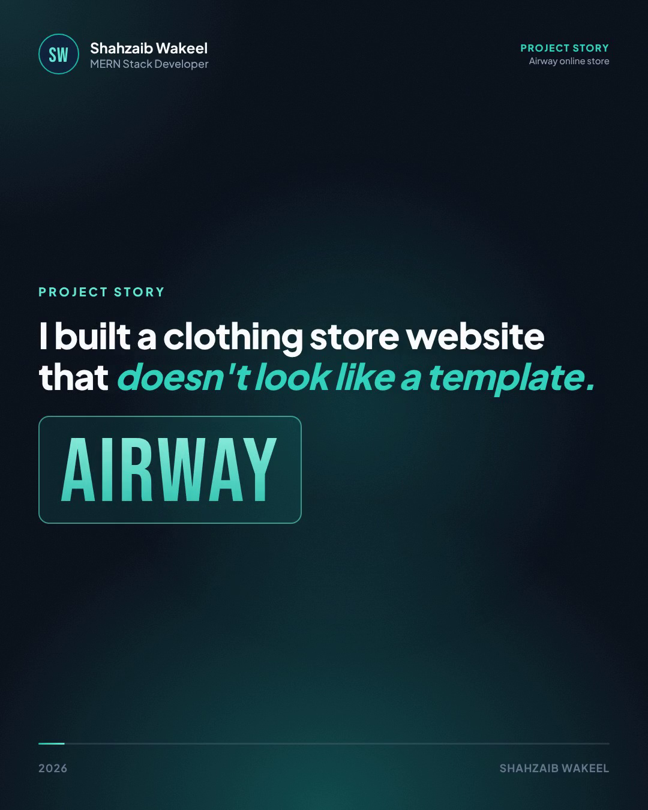
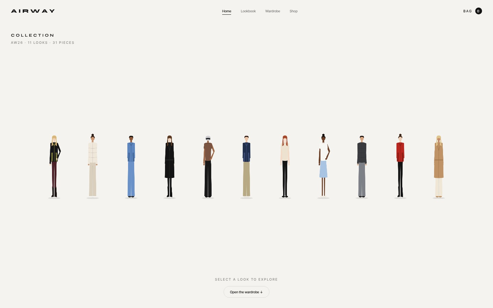
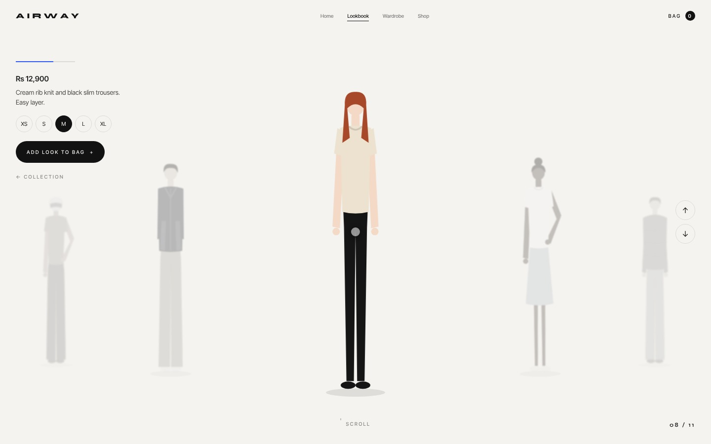
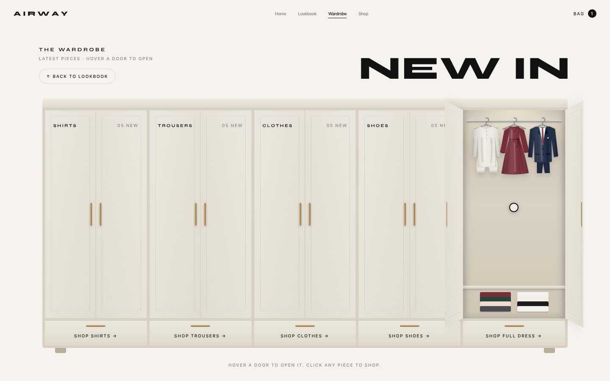
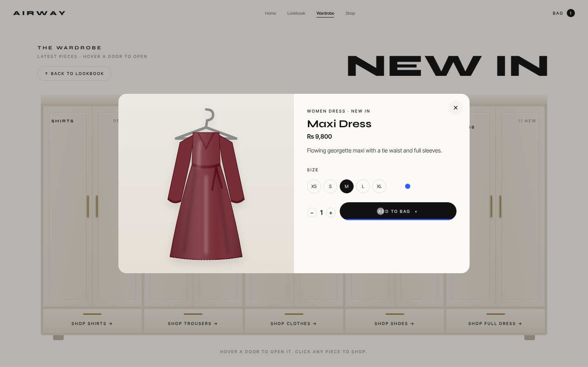
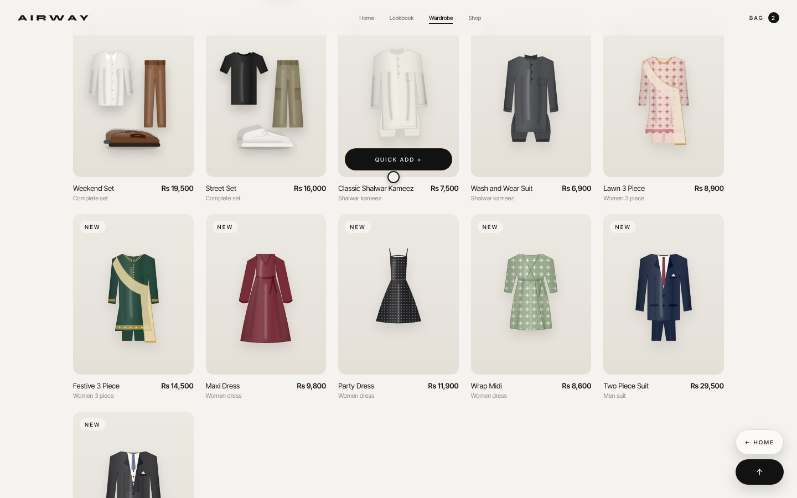
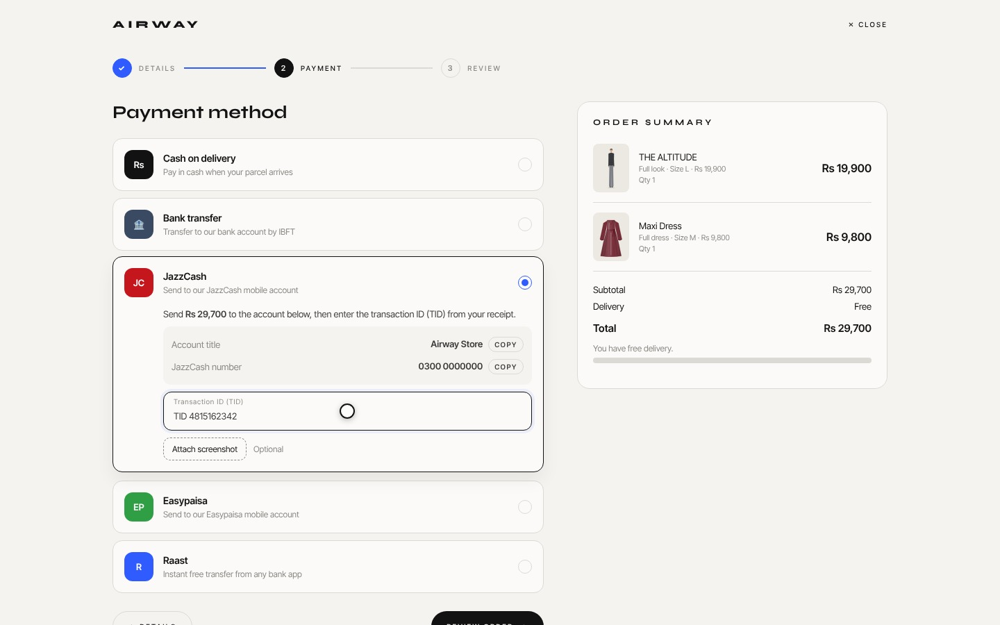
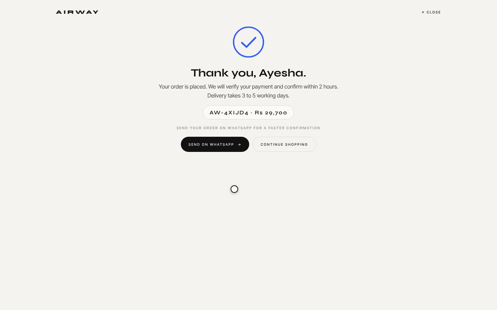
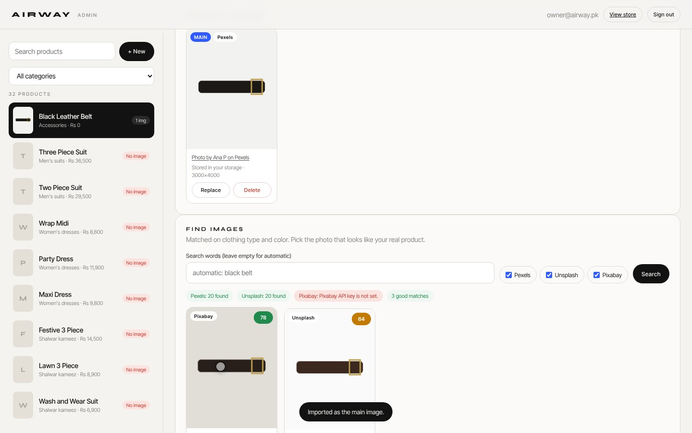
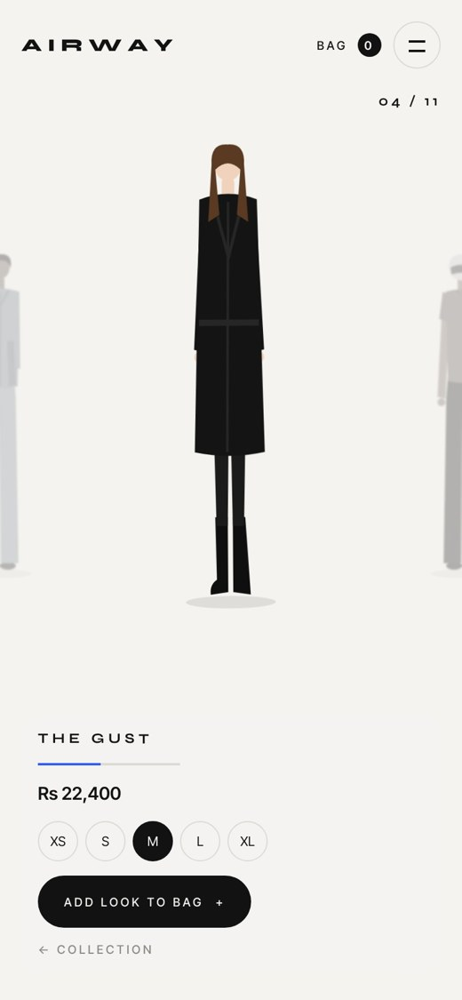

# Airway | Animated Online Clothing Store

An e-commerce website I built for a clothing brand. Instead of a normal product grid, the home page is a lookbook, and products sit inside an animated wardrobe. Checkout supports the payment methods people actually use in Pakistan. There is also an admin panel that searches stock photo sites for product images.

**Live demo:** https://shahzaib-33.github.io/airway-store/
**Demo video:** [docs/airway-demo.mp4](docs/airway-demo.mp4)

Built by **Shahzaib Wakeel**. If you need a website for your business, message me on LinkedIn or email chadhuaryzaib@gmail.com.



## Features

**Storefront**
- Lookbook home page. Click a look and it zooms in, with neighbours fading and blurring at the sides. Scroll, swipe or use the arrow keys to move through the collection.
- 3D wardrobe with five sections (shirts, trousers, clothes, shoes, full dress). Doors swing open on hover and clothes swing on their hangers.
- 31 products and 11 styled looks: shirts, trousers, jackets, shoes, shalwar kameez, women's 3 piece suits, dresses, men's suits and outfit sets.
- Quick view, sizes, quantities, and a bag drawer that remembers its contents.
- Three step checkout: delivery details with Pakistani phone validation, then payment, then review.
- Payment methods: cash on delivery, bank transfer, JazzCash, Easypaisa and Raast, with copy buttons and transaction ID capture.
- The order confirmation sends the full order to the store's WhatsApp in one tap.
- Fully responsive, with a full screen phone menu. Respects reduced motion settings.

**Admin panel and image system**
- Add a product and it automatically searches Pexels, Unsplash and Pixabay using the product name, category and color.
- Every photo is checked: broken, duplicate, branded, watermarked, low resolution and unrelated photos are filtered out. Each result gets a match score for item type and color.
- One click import. The server creates optimized product images and thumbnails and saves them with credits and license details.
- Replace, delete or set the main image. Follows each provider's API rules for attribution and hotlinking.

## Screenshots

| Lookbook | Look zoom | Wardrobe |
|---|---|---|
|  |  |  |
| **Quick view** | **Shop** | **Checkout** |
|  |  |  |
| **Order confirmed** | **Admin image search** | **Mobile** |
|  |  |  |

## Tech stack

- Frontend: HTML, CSS and vanilla JavaScript (no framework), CSS 3D transforms, Web Animations API
- Backend: Supabase (PostgreSQL with row level security, Auth, Storage)
- Server functions: Supabase Edge Functions in TypeScript (Deno)
- Image processing: imagescript (decode, resize, perceptual hashing, color analysis)
- Image sources: Pexels API, Unsplash API, Pixabay API
- Tests: PostgreSQL tests, Deno unit tests, Playwright browser tests

The live demo runs in offline mode with the built-in catalog. Connect a Supabase project (steps below) to switch on the database, admin panel and image import.

## Project structure

```
index.html                  the store (works offline with built-in products, uses the database when connected)
admin.html                  the admin panel (sign in, products, image search, import, replace, delete)
js/config.js                your Supabase URL and anon key (the only file you must edit)
js/api.js                   data layer shared by store and admin
js/admin.js                 admin panel logic
js/vendor/supabase.js       Supabase browser client (MIT license)
supabase/migrations/        database tables, security rules, storage bucket
supabase/seed.sql           the 31 products already in the store
supabase/functions/         server functions: image-search, image-import, image-manage
tests/                      database, server and browser tests
```

## How the image system works

1. You add a product in the admin panel with its name, category and color.
2. The panel searches Pexels, Unsplash and Pixabay at the same time, using the color and the clothing type, for example "black belt" or "white oxford".
3. Every result is checked before you see it:
   - Broken links and corrupt files are dropped. Every preview is downloaded and decoded.
   - Branded goods, logos and watermarked or text images are dropped by their tags (Nike, Gucci, logo, watermark and similar).
   - Low resolution photos are dropped. The shortest side must be at least 600 px.
   - Photos of other item types are dropped. For example, a shoe photo in a shirt search.
   - Photos of people are pushed down or dropped, so fashion model shots are not offered as product photos.
   - Duplicates are dropped: the same photo from two providers, or a photo already used anywhere in your store. A 64 bit image fingerprint catches near copies.
   - Each photo gets a 0 to 100 score for item type, color match (measured from the pixels of the item itself), plain product style background, and resolution. Scores below 40 are not shown.
4. You pick the photo that looks most like your real product and click Import.
5. The import runs on the server. It looks the photo up again by its id and never trusts a URL sent from the browser. Then:
   - Pexels and Pixabay: the file is downloaded and checked again. The server saves an optimized product image (longest side 1600 px, JPEG quality 82) and a 480 x 640 thumbnail (JPEG quality 76) to your `product-images` storage bucket.
   - Unsplash: the image is linked from Unsplash with its tracking id kept, sized by Unsplash's own resize settings, and the required download event is sent (see licensing below).
6. A row is saved in `product_images` with the product id, product name, category, image URL, thumbnail URL, provider, photographer, license and attribution text.
7. The first image becomes the main image. You can make another one main, replace one or delete one. Deleting also removes the stored files.

The store reads the `product_catalog` view. Products with a main image show the photo, with the photographer credited on the card and in the quick view. Products without one keep their drawing.

## Licensing and attribution

| Provider | How images are used | What the store shows |
|---|---|---|
| Pexels | Downloaded and stored in your bucket. Pexels allows this. | "Photo by NAME on Pexels" with a link, plus a Pexels link wherever search results show |
| Unsplash | Linked from Unsplash (hotlinked), never copied. The download event is sent on import. Both are required by the Unsplash API guidelines. | "Photo by NAME on Unsplash" with utm links to the photographer and Unsplash |
| Pixabay | Downloaded and stored in your bucket. Pixabay does not allow permanent hotlinking. | "Image by NAME from Pixabay" and a Pixabay link wherever search results show |

Important:
- Stock photos show a similar item, not your exact product. Always pick a photo that truly matches what you sell, and replace it with your own photo when you have one. Customers must not receive something different from the picture.
- The Pexels guidelines say you must not imply that people or brands in a photo endorse your product. The brand filter helps, but check each photo.
- Unsplash starts in demo mode (50 requests per hour). Apply for production in your Unsplash dashboard when the store is live.
- Pexels allows 200 requests per hour by default. Each search uses one request per provider. Repeated searches are cached for 10 minutes.
- None of the three providers watermarks API images. The tag filter drops images described as watermarked. Look at each photo before importing anyway.

## Setup (about 20 minutes)

### 1. Create the Supabase project
1. Sign up at https://supabase.com and create a new project (the free plan is enough).
2. Open SQL Editor, paste `supabase/migrations/20261106000000_product_image_system.sql` and run it.
3. Paste `supabase/seed.sql` and run it. This adds your 31 existing products.

### 2. Create your admin login
1. Authentication > Users > Add user. Enter your email and a strong password.
2. In SQL Editor run, with your own email in lower case:
   ```sql
   insert into public.admins (email) values ('you@example.com');
   ```

### 3. Get the three free API keys
- Pexels: https://www.pexels.com/api/new/
- Unsplash: https://unsplash.com/oauth/applications (create an app and copy the Access Key. The app name is used in attribution links.)
- Pixabay: https://pixabay.com/api/docs/ (sign in and the key is shown on the page)

### 4. Deploy the server functions
Install the Supabase CLI (https://supabase.com/docs/guides/cli), then from this folder:
```bash
supabase login
supabase link --project-ref YOUR_PROJECT_REF
supabase secrets set PEXELS_API_KEY=... UNSPLASH_ACCESS_KEY=... UNSPLASH_APP_NAME=airway_store PIXABAY_API_KEY=...
supabase secrets set ALLOWED_ORIGINS=https://YOUR_GITHUB_NAME.github.io
supabase functions deploy image-search
supabase functions deploy image-import
supabase functions deploy image-manage
```
The keys stay on the server. They are never sent to the browser.

### 5. Connect the website
Edit `js/config.js` and paste your Project URL and anon (publishable) key from Project Settings > API. Never paste the service role key.

### 6. Put it online
Upload this folder to a GitHub repository and turn on GitHub Pages (Settings > Pages > Deploy from branch > main / root). The store is at `https://YOUR_GITHUB_NAME.github.io/REPO/` and the admin is at `/admin.html`.

## Store settings
Payment account numbers, the WhatsApp number and delivery fees are in the `STORE` block near the top of the script in `index.html`.

## Tests
```bash
bash tests/db/run.sh                  # migration, seed and security rules on a local Postgres (run as a non root user)
deno test -A tests/functions          # search, filters, scoring and import with fake provider APIs
python3 tests/ui/run_ui.py            # admin panel and store in a real browser (Playwright)
```
